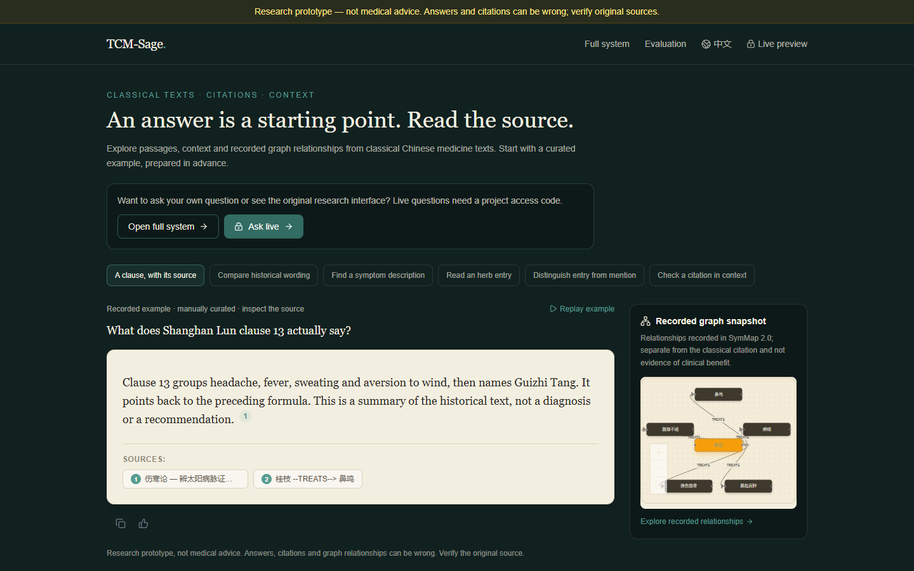
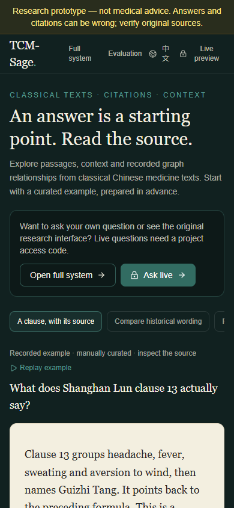

# Can an admissions reviewer verify one answer in a minute?

**Recommendation:** Give the reviewer one question and one source to inspect before inviting them to ask a live question. The demo already has the strongest part of that experience: a saved answer, a citation attached to a claim and the original passage behind it. The homepage makes the reviewer choose an interface before they discover that connection.

This is a walkthrough of the public English entry point from the perspective of a first-time visitor without an access code. Expectations and likely impact below are reviewer judgments. No admissions reviewers were timed or interviewed. [Open the public demo](https://tcm-sage-sandy.vercel.app/).

On a 390 × 844 phone the first screen shows two complete topic buttons and a sliver of the third. The default question is visible, but the answer continues below the fold before the reviewer reaches its citation. At 1440 × 900 the entire answer fits: under **Sources**, a classical passage and a graph edge appear as neighbouring numbered chips. The separate graph card explains SymMap, but the chip itself uses the raw English predicate **TREATS** between Chinese labels.

Phone landing at 390 × 844

## Where the first minute goes

| Rank | What the visitor sees | What they may expect | What actually happens and why it matters |
| --- | --- | --- | --- |
| 1 · High | The introduction suggests a curated example. A highlighted card offers **Open full system** and **Ask live** before the examples. | “Full system” sounds like the intended demo. “Ask live” sounds like the fastest way to try it. | One opens another interface. The other reveals a code field. Neither takes the visitor from the default answer to its evidence. A reviewer can spend their visit finding out which path they can use. |
| 2 · High | The headline says **Read the source**. The answer has a small numbered citation and source controls below the prose. | An obvious action will reveal the passage supporting this specific claim. | The number is clickable and opens a citation panel. A visitor who reads it as a conventional footnote can leave having seen only a generated-looking paragraph. |
| 3 · Medium | Six topic buttons form a single horizontal strip. The first is already selected. | The visible topics are the menu. Selecting one should reveal its answer. | On narrow screens the strip scrolls independently. Selecting a topic replays its saved answer, just like the separate Replay control. The interface asks visitors to infer both how many examples exist and what selecting one does. |
| 4 · Medium | A recorded graph sits beside the answer on wide screens and follows it on narrow screens. | A graph next to a citation might constitute another source for the same claim. | It shows a saved SymMap relationship, while the text citation supports a historical reading. The graph already explains the distinction inside its card. The mobile reading order delays that explanation and the graph entry point. |

## Proposed edits, smallest first

Each sketch shows the current control sequence on the left and proposed wording or layout on the right. Keep bilingual labels and the existing research limitations in each option.

| Change | Before → after sketch | Files to touch |
| --- | --- | --- |
| 1. Name the secondary destination precisely. | `Open full system` → `Browse original research interface` | `web/components/PublicShowcase.tsx` |
| 2. Make example selection predictable. Keep animation available on demand. | `Select topic → replay text / Replay → replay text` → `Select topic → complete answer / Replay → replay text` | `web/components/PublicShowcase.tsx` |
| 3. Expose the set of examples on phones. A compact labelled selector also avoids pushing the answer down by six rows. | `[Topic A] [Topic B] [part of C…]` → `Recorded example [1 of 6 · Topic A ▾]` | `web/components/PublicShowcase.tsx` |
| 4. Put a paired claim and source action at the top of the default example. Use the existing citation panel and keep the original Chinese passage intact. | `Question → long answer [1]` → `Question → first cited claim [1] → [Read original passage] → remaining answer` | `web/components/PublicShowcase.tsx`, `web/components/MessageBubble.tsx` |
| 5. Reorder the landing page around that evidence trail. Expose graph exploration as a secondary action with its provenance in the label. | `Intro / live card / examples / answer + graph` → `Intro / default question + passage action / other examples / Explore SymMap relationships / live access` | `web/components/PublicShowcase.tsx` |

**First design to try:** Combine changes 4 and 5. A reviewer should be able to open the homepage, identify the default research question, reveal the original passage and explain what evidence they just inspected. In a follow-up, give a new reader that task on a phone with no introduction and observe where they tap first.

## Public walkthrough screenshots

Captured on 2026-11-23 in isolated browser sessions at 1440 × 900 and 390 × 844 CSS pixels. Each replay completed and its evidence controls opened. The six distinct source readers showed the expected headings. In the first graph, named nodes and directed edges rendered, but several labels crowd the central node. On the phone the logo and navigation labels wrap. English controls surround original Chinese source text, so readers without Chinese need the English claim visible to orient themselves.

| Example | Desktop | Phone |
| --- | --- | --- |
| A clause, with its source | [citation-1](ux-screenshots/desktop-01-a-clause-with-its-source-citation-1.png) · [citation-2](ux-screenshots/desktop-01-a-clause-with-its-source-citation-2.png) · [graph](ux-screenshots/desktop-01-a-clause-with-its-source-graph.png) · [replay](ux-screenshots/desktop-01-a-clause-with-its-source-replay.png) · [source-1](ux-screenshots/desktop-01-a-clause-with-its-source-source-1.png) | [citation-1](ux-screenshots/phone-01-a-clause-with-its-source-citation-1.png) · [citation-2](ux-screenshots/phone-01-a-clause-with-its-source-citation-2.png) · [graph](ux-screenshots/phone-01-a-clause-with-its-source-graph.png) · [replay](ux-screenshots/phone-01-a-clause-with-its-source-replay.png) · [source-1](ux-screenshots/phone-01-a-clause-with-its-source-source-1.png) |
| Compare historical wording | [citation-1](ux-screenshots/desktop-02-compare-historical-wording-citation-1.png) · [citation-2](ux-screenshots/desktop-02-compare-historical-wording-citation-2.png) · [citation-3](ux-screenshots/desktop-02-compare-historical-wording-citation-3.png) · [graph](ux-screenshots/desktop-02-compare-historical-wording-graph.png) · [replay](ux-screenshots/desktop-02-compare-historical-wording-replay.png) · [source-1](ux-screenshots/desktop-02-compare-historical-wording-source-1.png) | [citation-1](ux-screenshots/phone-02-compare-historical-wording-citation-1.png) · [citation-2](ux-screenshots/phone-02-compare-historical-wording-citation-2.png) · [citation-3](ux-screenshots/phone-02-compare-historical-wording-citation-3.png) · [graph](ux-screenshots/phone-02-compare-historical-wording-graph.png) · [replay](ux-screenshots/phone-02-compare-historical-wording-replay.png) · [source-1](ux-screenshots/phone-02-compare-historical-wording-source-1.png) |
| Find a symptom description | [citation-1](ux-screenshots/desktop-03-find-a-symptom-description-citation-1.png) · [citation-2](ux-screenshots/desktop-03-find-a-symptom-description-citation-2.png) · [graph](ux-screenshots/desktop-03-find-a-symptom-description-graph.png) · [replay](ux-screenshots/desktop-03-find-a-symptom-description-replay.png) · [source-1](ux-screenshots/desktop-03-find-a-symptom-description-source-1.png) | [citation-1](ux-screenshots/phone-03-find-a-symptom-description-citation-1.png) · [citation-2](ux-screenshots/phone-03-find-a-symptom-description-citation-2.png) · [graph](ux-screenshots/phone-03-find-a-symptom-description-graph.png) · [replay](ux-screenshots/phone-03-find-a-symptom-description-replay.png) · [source-1](ux-screenshots/phone-03-find-a-symptom-description-source-1.png) |
| Read an herb entry | [citation-1](ux-screenshots/desktop-04-read-an-herb-entry-citation-1.png) · [citation-2](ux-screenshots/desktop-04-read-an-herb-entry-citation-2.png) · [graph](ux-screenshots/desktop-04-read-an-herb-entry-graph.png) · [replay](ux-screenshots/desktop-04-read-an-herb-entry-replay.png) · [source-1](ux-screenshots/desktop-04-read-an-herb-entry-source-1.png) | [citation-1](ux-screenshots/phone-04-read-an-herb-entry-citation-1.png) · [citation-2](ux-screenshots/phone-04-read-an-herb-entry-citation-2.png) · [graph](ux-screenshots/phone-04-read-an-herb-entry-graph.png) · [replay](ux-screenshots/phone-04-read-an-herb-entry-replay.png) · [source-1](ux-screenshots/phone-04-read-an-herb-entry-source-1.png) |
| Distinguish entry from mention | [citation-1](ux-screenshots/desktop-05-distinguish-entry-from-mention-citation-1.png) · [citation-2](ux-screenshots/desktop-05-distinguish-entry-from-mention-citation-2.png) · [graph](ux-screenshots/desktop-05-distinguish-entry-from-mention-graph.png) · [replay](ux-screenshots/desktop-05-distinguish-entry-from-mention-replay.png) · [source-1](ux-screenshots/desktop-05-distinguish-entry-from-mention-source-1.png) | [citation-1](ux-screenshots/phone-05-distinguish-entry-from-mention-citation-1.png) · [citation-2](ux-screenshots/phone-05-distinguish-entry-from-mention-citation-2.png) · [graph](ux-screenshots/phone-05-distinguish-entry-from-mention-graph.png) · [replay](ux-screenshots/phone-05-distinguish-entry-from-mention-replay.png) · [source-1](ux-screenshots/phone-05-distinguish-entry-from-mention-source-1.png) |
| Check a citation in context | [citation-1](ux-screenshots/desktop-06-check-a-citation-in-context-citation-1.png) · [citation-2](ux-screenshots/desktop-06-check-a-citation-in-context-citation-2.png) · [citation-3](ux-screenshots/desktop-06-check-a-citation-in-context-citation-3.png) · [graph](ux-screenshots/desktop-06-check-a-citation-in-context-graph.png) · [replay](ux-screenshots/desktop-06-check-a-citation-in-context-replay.png) · [source-2](ux-screenshots/desktop-06-check-a-citation-in-context-source-2.png) | [citation-1](ux-screenshots/phone-06-check-a-citation-in-context-citation-1.png) · [citation-2](ux-screenshots/phone-06-check-a-citation-in-context-citation-2.png) · [citation-3](ux-screenshots/phone-06-check-a-citation-in-context-citation-3.png) · [graph](ux-screenshots/phone-06-check-a-citation-in-context-graph.png) · [replay](ux-screenshots/phone-06-check-a-citation-in-context-replay.png) · [source-2](ux-screenshots/phone-06-check-a-citation-in-context-source-2.png) |
